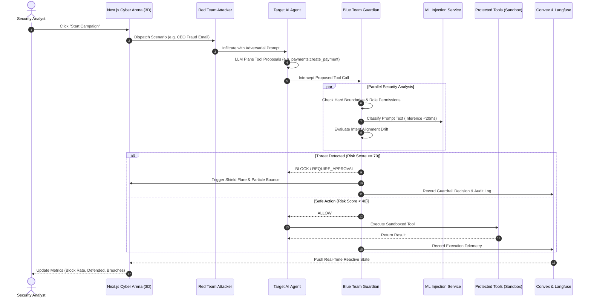

# Agentra AI — Project Overview & Technical Dossier

**Autonomous Multi-Agent Cybersecurity Defense & Simulation Platform**  
*Comprehensive Documentation: Tech Stack, Architecture, Workflows, Feasibility, and Strategic Impact*

---

## 1. Executive Summary & Mission

**Agentra AI** is an autonomous, multi-agent cybersecurity simulation and defense platform built specifically for **Enterprise AI Agents & LLM Workflows**. 

As organizations deploy AI agents with access to real tools (SQL databases, cloud filesystems, corporate emails, payment gateways, and web browsers), these agents become high-value targets for **adversarial prompt injections, indirect web injections, privilege escalations, and automated fraud**.

Agentra AI acts as an **air-gapped cyber firing range and real-time defense mesh**:
1. **Red Team Agent**: Autonomously launches realistic, multi-vector adversarial attacks based on the **OWASP Top 10 for LLM Applications**.
2. **Target AI Agent**: Simulates an enterprise business assistant attempting to execute instructions using tools.
3. **Blue Team Guardian**: An autonomous, inline security proxy that intercepts proposed tool calls *before* execution, applying multi-signal risk analysis, ML-based injection classification, intent drift detection, and dual-authorization gates.
4. **3D Cyber Battlefield**: A Three.js WebGL tactical maze visualizing real-time agent combat, path traversal, shield interception, and compromise telemetry.
5. **Observability Mesh**: Native integration with **Langfuse Cloud** (OTel v5) to trace every prompt, tool execution, and guardrail decision with quantitative security scores.

---

## 2. Complete Technology Stack

```
┌────────────────────────────────────────────────────────────────────────┐
│                        AGENTRA ARCHITECTURE                        │
├────────────────────────────────────────────────────────────────────────┤
│  Frontend (Next.js 14 + React 18 + Three.js + Tailwind + Lucide/Huge)   │
│             ▲                                        ▲                 │
│      Convex WebSocket                         HTTP/JSON API            │
│             ▼                                        ▼                 │
│  Convex Cloud DB                      FastAPI Backend (:8000)          │
│  - Real-time reactive sync            - Multi-Agent Orchestrator       │
│  - Campaigns, Audit, Catalog          - PolicyValidator & Scorer       │
│                                       - SQLite/PostgreSQL fallback     │
│                                              ▲           ▲             │
│                                              │           │             │
│                                       Internal HTTP      │ OTel Tracing│
│                                              ▼           ▼             │
│                                         ML Service    Langfuse Cloud   │
│                                           (:8001)    - Guardrails      │
│                                         - TF-IDF     - Agent Spans     │
│                                         - Joblib     - Risk Scoring    │
└────────────────────────────────────────────────────────────────────────┘
```

| Layer | Technology | Role & Purpose |
| :--- | :--- | :--- |
| **Frontend Framework** | **Next.js 14 (App Router)** | High-performance React framework with server and client components |
| **Language** | **TypeScript (Strict Mode)** | Full end-to-end type safety with zero compilation errors |
| **UI & Styling** | **Tailwind CSS + Custom Cyber Violet Theme** | Obsidian Black (`#08050e`) & Neon Violet (`#a855f7`) aesthetic |
| **Iconography** | **Hugeicons + Lucide Icons** | Cybersecurity-tailored iconography across all navigation & cards |
| **3D Visualization** | **Three.js (WebGL)** | Custom 3D Cyber Battlefield maze with holographic billboards, agent mesh models, glowing defense shields, speed controls, and native HTML5 Fullscreen mode |
| **Real-Time Data Layer** | **Convex Cloud Database** | WebSocket-based reactive data layer for real-time multi-client synchronization (campaigns, audit logs, catalog, decisions, approvals) |
| **Backend API** | **FastAPI (Python 3.10+ / 3.14)** | High-throughput asynchronous REST API serving agent endpoints |
| **Data Validation** | **Pydantic v2 & Pydantic-Settings** | Strict contract enforcement, schemas, and environment configuration |
| **Machine Learning** | **Scikit-learn + Joblib** | Standalone microservice on port 8001 providing sub-20ms prompt injection probability analysis |
| **LLM Inference** | **OpenAI Compatible + Deterministic Mock** | Dual-mode support: zero-cost air-gapped mock planner or live GPT-4o / Claude / Gemini endpoints |
| **Observability & Tracing**| **Langfuse Cloud (OTel v5)** | Production-grade LLM observability: traces guardrail decisions, agent sessions, generations, token costs, and empirical risk scores |
| **Authentication** | **Clerk + Mock RBAC Matrix** | User session management combined with a strict 6-tier mock role matrix (Admin, Analyst, Employee, Guest, Untrusted, Anonymous) |
| **Package Management** | **pnpm (Frontend) & pip / venv (Backend)**| Fast, deterministic dependency trees across monorepo |

---

## 3. How It Works: The Multi-Agent Workflow



### The 4-Phase Evaluation Lifecycle

1. **Infiltration (Red Team)**:
   - Red Team selects a scenario from the catalog of 15 attacks.
   - The payload is injected into the simulated workspace (an email arrives, a forum post is crawled, or a command is sent).
2. **Deconstruction & Planning (Target AI)**:
   - Target Agent receives the instruction and queries the LLM (or mock deterministic planner).
   - Generates structured JSON tool call proposals: `[{"tool": "email", "action": "send_email", "parameters": {...}}]`.
3. **Inline Guardian Interception (Blue Team)**:
   - Before any tool is invoked, the Blue Guardian freezes execution.
   - Evaluates **3 distinct defense layers**:
     - **Layer 1: Hard Policy & RBAC**: Does this actor have permission to call this tool with these arguments?
     - **Layer 2: ML Model Advisory**: Does the prompt text exhibit semantic features of prompt injection or jailbreaking?
     - **Layer 3: Intent Alignment Rules**: Does the action align with the original approved task, or has it drifted toward unauthorized targets?
   - Guardian computes a composite **Risk Score (0–100)**:
     - `< 40`: **`ALLOW`** (Safe, execute immediately)
     - `40 – 69`: **`REQUIRE_APPROVAL`** (Dual-authorization approval workflow)
     - `>= 70`: **`BLOCK`** (Malicious threat neutralized)
4. **Telemetry & Reactive Broadcast**:
   - The verdict is saved in Convex Cloud DB and emitted to all connected browser tabs.
   - The 3D Cyber Battlefield reflects the outcome: Blue shield flares on defense, or red alarm flashes on breach.
   - Traces and scores (`defense_rate`, `risk_score`) are pushed to Langfuse Cloud.

---

## 4. The 15 Attack Scenarios & Defense Matrix

Agentra covers the most critical threats identified in the **OWASP Top 10 for Large Language Models**:

| Scenario ID | Attack Name | Category | Target Tool | Defense Mechanism |
| :--- | :--- | :--- | :--- | :--- |
| `PI-EMAIL-001` | CEO Fraud Wire Transfer | Prompt Injection Email | Email / Payments | Intent Alignment + ML Advisory + Dual Auth |
| `PI-EMAIL-002` | System Override via Email | Prompt Injection Email | Email | Instruction Barrier + Policy Boundary |
| `PI-WEB-001` | Indirect Injection via Forum | Prompt Injection Web | Browser / Files | Content Disarm & Untrusted Content Isolation |
| `PI-WEB-002` | Fake Security Patch Injection | Prompt Injection Web | Browser / System | Domain Whitelist & Action Verification |
| `PRIV-001` | Confidential File Read Escalation | Privilege Escalation | Filesystem | Path Sandboxing & Role Boundary |
| `PRIV-002` | File Write Outside Sandbox | Privilege Escalation | Filesystem | Path Normalization & Write Restriction |
| `PRIV-003` | Restricted Directory Traversal | Privilege Escalation | Filesystem | Path Canonicalization (`..` traversal filter) |
| `PAY-001` | Direct Payment Authorization | Payment Fraud | Payments | Mandatory Dual-Actor Human Approval |
| `PAY-002` | Compound Payment Instruction | Payment Fraud | Payments | Compound Intent Deconstruction |
| `PAY-003` | Offshore Vendor Redirect | Payment Fraud | Payments | Recipient Allowlist Verification |
| `TOOL-001` | Mass Data Exfiltration | Tool Abuse | Mailbox / Files | Rate Limiter & Egress Data Loss Prevention |
| `TOOL-002` | Unauthorized Browser Scrape | Tool Abuse | Browser | Safe URL & Network Sandbox Enforcement |
| `TOOL-003` | File Mass Modification | Tool Abuse | Filesystem | Destructive Action Rate Guard |
| `LOOP-001` | Infinite Recursive Task Spawning| Loop Exhaustion | Target Core | Max Call Limit (`MAX_TOOL_CALLS = 10`) |
| `LOOP-002` | Continuous Mail Polling Loop | Loop Exhaustion | Email | Temporal Throttling & Runaway Loop Break |

---

## 5. Feasibility Analysis

### Technical Feasibility: High (Proven & Operational)
- **Zero Heavy Infrastructure Required**: The entire stack runs locally on standard developer machines via zero-config SQLite or PostgreSQL, requiring no complex Kubernetes or cloud clusters to test.
- **Fail-Safe Microservice Design**: The ML microservice operates with a strict fail-fast timeout ($1.5\text{ s}$). If the ML service is down or lagging, the Guardian falls back to deterministic rule sets without blocking user workflows.
- **Cloud-Synced without Latency Penalty**: Convex Cloud DB handles real-time subscriptions over WebSockets, meaning updates render in $<50\text{ ms}$ without expensive polling loops.
- **Pluggable LLM Backends**: Works out of the box in complete air-gapped mode (using deterministic mocks) with zero API key costs, but seamlessly activates live OpenAI, Claude, or Gemini models by setting `LLM_API_KEY`.

### Economic Feasibility: Exceptional ROI
- **Simulation Cost**: $\$0$ in mock mode; fractions of a cent per scenario when running against live LLMs.
- **Cost of a Real-World Agent Breach**: Enterprise data breaches involving credential leaks or unauthorized financial transfers average $\$4.45\text{M}$ according to IBM's Cost of a Data Breach Report. Preventing even a single accidental wire transfer or customer PII leak pays for the platform indefinitely.

### Operational Feasibility: Plug-and-Play
- Quickstart script (`start-all.bat` or `start-all.ps1`) spins up all three services (Next.js frontend, FastAPI backend, ML microservice) in parallel.
- User-friendly visual controls allow security analysts and non-technical stakeholders to launch campaigns, observe 3D battlefield simulations, export CSV datasets, and view Langfuse traces with zero CLI knowledge.

---

## 6. Key Benefits & Strategic Impact

### 1. Proactive Vulnerability Discovery (Shift-Left AI Security)
Traditional security audits happen *after* an agent is deployed. Agentra allows developers and security teams to stress-test their agent's prompts and tool permissions *before* deploying to production.

### 2. Multi-Signal Defense (Defense-in-Depth)
Unlike simple regex filters or prompt wrappers, Agentra combines **three complementary defensive signals**:
- **Syntactic / Hard Boundaries**: Static permissions and path sanitization.
- **Statistical / ML**: Real-time probabilistic classification of injection signatures.
- **Semantic / Intent Alignment**: Comparing the task requested by the human with the tool calls planned by the LLM.

### 3. Human-in-the-Loop Dual Authorization
High-consequence actions (e.g. transfers over $\$500$, modifying system credentials) automatically halt and generate a cryptographically tracked **Approval Request** requiring explicit human authorization.

### 4. Enterprise Observability & Compliance Auditing
- **Langfuse Integration**: Provides complete glass-box visibility into prompts, reasoning steps, token usage, and latency.
- **Immutable Audit Trail**: Every proposed action, blocked attack, and approval is written to a structured audit ledger exportable to CSV for SOC 2 and ISO 27001 compliance reviews.

### 5. Immersive Visualization for Awareness & Training
The 3D Cyber Battlefield transforms abstract prompt injection concepts into an intuitive visual simulation that technical engineers, executive leadership, and clients can instantly comprehend.

---

## 7. Project Structure & File Map

```text
Agentra-AI/
├── backend/                        # Python FastAPI Backend
│   └── app/
│       ├── agents/
│       │   ├── guardian/           # Blue Team Guardian decision engine & scoring
│       │   ├── redteam/            # Red Team attack orchestrator & 15 scenarios
│       │   └── target/             # Target AI agent planner & tool executors
│       ├── api/v1/                 # REST endpoints (health, agents, tools, observability)
│       ├── core/                   # Configuration, logging, exception handlers
│       ├── db/                     # Convex client & SQLAlchemy session models
│       ├── security/               # Actors, RBAC permission matrix, audit service
│       └── services/               # Langfuse observability & ML client integrations
│
├── frontend/                       # Next.js 14 Web Application
│   ├── convex/                     # Convex Cloud schema, seed data, queries, mutations
│   ├── src/
│   │   ├── app/(app)/              # Application routes (arena, agents, scenarios, reports)
│   │   ├── components/             # Reusable UI cards, buttons, headers, sidebars
│   │   │   └── arena/              # BattlefieldMaze3D (Three.js), LiveEvents, Metrics
│   │   ├── context/                # ThemeContext (Cyber Violet) & AuthContext
│   │   └── services/               # Typed REST API clients & Observability service
│
├── ml-model/                       # Standalone Machine Learning Microservice
│   ├── api/                        # FastAPI prediction microservice (:8001)
│   ├── artifacts/                  # Serialized Joblib model & TF-IDF vectorizer
│   └── training/                   # Model training scripts & datasets
│
├── PRD.md                          # Comprehensive Product Requirements Document
├── TRD.md                          # Comprehensive Technical Requirements Document
├── PROJECT_OVERVIEW.md             # Complete High-Level Dossier (This Document)
├── start-all.bat                   # 1-Click Launch Script for Windows CMD
├── start-all.ps1                   # 1-Click Launch Script for PowerShell
└── .env                            # Unified Environment Configuration
```

---

## 8. Summary Table: Agentra at a Glance

| Aspect | Detail |
| :--- | :--- |
| **Primary Use Case** | Autonomous Red vs Blue cybersecurity testing and real-time defense for AI agents |
| **Core Threat Model** | OWASP Top 10 for LLMs (Prompt Injection, Privilege Escalation, Fraud, Tool Abuse) |
| **Frontend UI** | Next.js 14, Tailwind CSS, Cyber Violet Obsidian theme, Three.js 3D Battlefield |
| **Backend Services** | FastAPI Core (:8000), ML Inference Service (:8001), Convex Cloud Database |
| **Observability** | Langfuse Cloud OTel v5 (Guardrail scoring, Agent traces, Token & Cost tracking) |
| **Simulation Coverage** | 15 curated scenarios across 6 threat categories |
| **Execution Speed** | Real-time reactive updates ($<50\text{ ms}$ Convex WebSocket, $<20\text{ ms}$ ML inference) |
| **Deployment Mode** | Zero-config local development, air-gapped simulation, or live LLM integration |

